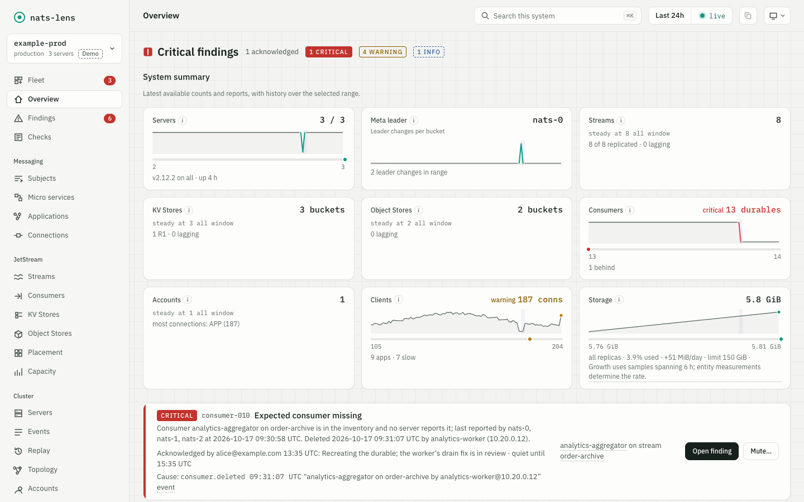
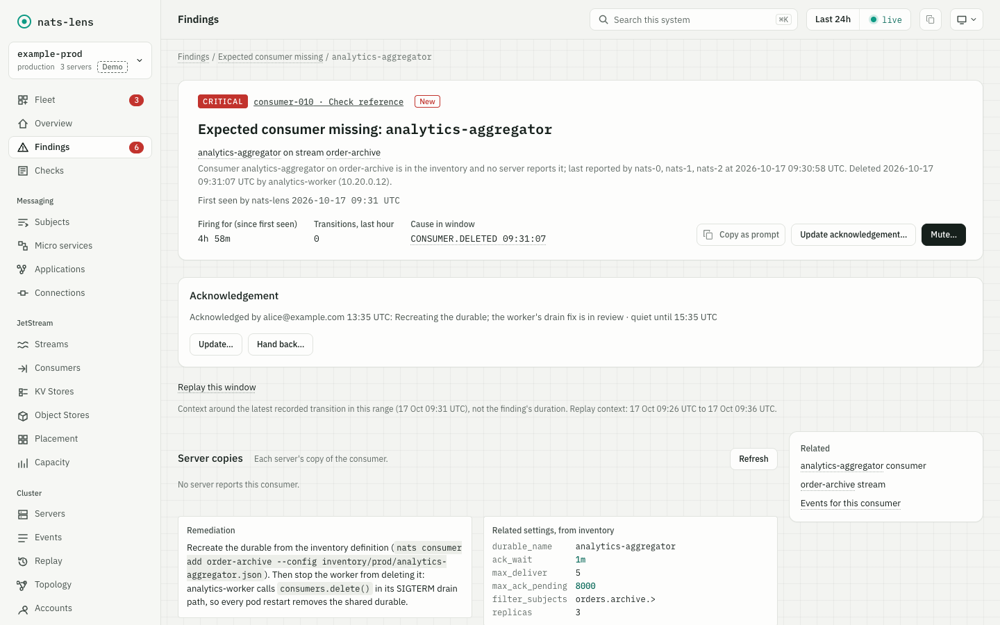
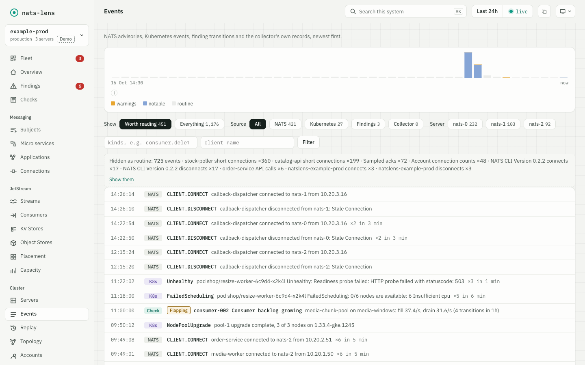

# nats-lens

[](https://github.com/shadone/nats-lens/actions/workflows/ci.yml)
[](https://github.com/shadone/nats-lens/releases/latest)
[](LICENSE)

nats-lens records what every server of your NATS system reports, turns it into findings with their own history, and shows it all in a web UI that ships in one binary.

<picture>
  <source media="(prefers-color-scheme: dark)" srcset="docs/images/overview-dark.png">
  
</picture>

nats-lens answers the questions that come after an incident: what failed, when, on which server, and what else happened at the same time. It is read-only towards NATS: it subscribes and sends monitoring requests, and it never publishes to an application subject.

## Try it

Run the demo. It serves three made-up NATS systems with a recorded incident, and needs no NATS server:

```sh
docker run --rm -p 127.0.0.1:8080:8080 ghcr.io/shadone/nats-lens demo -listen :8080
```

Open http://127.0.0.1:8080. Inside a container the demo must listen on all interfaces (`-listen :8080`), because its default address, 127.0.0.1:8080, cannot be reached through a published port.

### Watch your own NATS system

nats-lens connects as a user of the system account. Create a scoped user with the grants in [NATS permissions](docs/configuration.md#nats-permissions) instead of using the account's full user, which may also reload servers or put them into lame duck mode.

1. Download the archive for your platform (Linux amd64 or arm64, macOS arm64) from the [latest release](https://github.com/shadone/nats-lens/releases/latest) and unpack it.
2. Start the collector with the system account user:

   ```sh
   NATSLENS_NATS_PASSWORD=<password> ./natslens run -nats-url nats://nats.example.com:4222 -nats-user natslens
   ```

   With a credentials file, pass `-nats-creds ./sys.creds` instead of the user.

3. Open http://127.0.0.1:8080. nats-lens stores its data in `./data`.

To capture the stream and consumer advisories of a JetStream account, and for every other setting, use a configuration file: [natslens.example.yaml](natslens.example.yaml) lists every key, and [Configuration](docs/configuration.md) describes them.

The container image `ghcr.io/shadone/nats-lens` runs `natslens run -config /etc/natslens/natslens.yaml` by default, so mount your configuration file there. In a container, set `listen: ":8080"` with `iap_audience` or `allow_unauthenticated: true` (natslens refuses an API beyond loopback without one of them), and point `data_dir` at a writable volume. With `allow_unauthenticated: true`, anyone who reaches the port can mute findings, so publish it on 127.0.0.1 only.

### Run it in Kubernetes

[k8s/](k8s/) holds Kustomize manifests: a base, a component for GKE behind Identity-Aware Proxy (IAP), and two example overlays. [Deploy](docs/deploy.md) describes them, how to size memory and the volume, and how natslens behaves while NATS is unreachable.

### Build from source

nats-lens needs Go 1.27, Node.js 22.22, 24.15 or 26, and a C compiler for DuckDB:

```sh
git clone https://github.com/shadone/nats-lens.git
cd nats-lens
make build
bin/natslens demo
```

[Development](docs/development.md) lists the prerequisites, a local three-server cluster and the make targets.

## Why nats-lens

NATS servers answer monitoring requests about the present moment, and they publish advisories that nobody keeps. The usual tools work with that present moment. The `nats` CLI and nats-top show what the servers report now. prometheus-nats-exporter and NATS Surveyor turn the reports into Prometheus metrics, which a Grafana dashboard then shows over time.

nats-lens keeps the reports themselves, and adds what a metric does not carry:

- **What every server reported, kept.** Each collection stores every server's own answer. A single-replica stream appears only on its host, and when servers disagree about a stream's configuration or peers, the disagreement is in the data.
- **Findings with their own history.** 88 SQL checks and three built-in checks run after every collection. A finding records when it fired, changed severity and resolved, whether it flaps, and, where the check knows it, the event that caused it.
- **An event timeline.** Client connects and disconnects with their reason, authentication errors, stream and consumer changes with the client that made them, leader elections and quorum losses sit on one timeline with the findings.
- **Kubernetes context.** An optional watcher records pod restarts, evictions, node drains and upgrades beside the NATS events, so a node upgrade and the quorum loss it caused appear together.
- **One binary.** The collector, the embedded DuckDB database, the API and the web UI run in one process. No Prometheus, Grafana or database server is needed.

nats-lens also serves its findings at `/metrics`, so a Prometheus that already exists can alert on them, and it sends findings to webhook and Slack-compatible channels.

## Features

 

- [Monitoring snapshots](docs/features/monitoring-snapshots.md): every server's VARZ, CONNZ, JSZ, RAFTZ and other monitoring reports, once per collect interval.
- [Event capture](docs/features/event-capture.md): system events and JetStream advisories, with the server, account and client they concern.
- [Checks and findings](docs/features/checks.md): SQL checks for [servers](docs/features/server-checks.md), [streams](docs/features/stream-checks.md), [consumers](docs/features/consumer-checks.md), [clients](docs/features/client-checks.md), [accounts](docs/features/account-checks.md) and [nats-lens itself](docs/features/system-checks.md).
- [Inventory](docs/features/inventory.md): a file of the streams, consumers and buckets that must exist, and the client that deleted one that is missing.
- [Overview page](docs/features/overview-page.md) and [Fleet view](docs/features/multiple-systems.md): one system's state at a glance, or every system watched by one nats-lens.
- [Triage and mutes](docs/features/triage-and-mutes.md): acknowledge a finding while you investigate it, or mute it with a reason and an end time.
- [Replay](docs/features/replay.md): pick two moments and read what changed between them, in order.
- [Servers](docs/features/servers.md), [streams](docs/features/streams.md), [consumers](docs/features/consumers.md), [connections](docs/features/connections.md), [KV and object stores](docs/features/kv-and-object-stores.md), [placement](docs/features/placement.md), [capacity](docs/features/capacity.md) and [topology](docs/features/topology.md) pages.
- [Kubernetes context](docs/features/kubernetes-context.md): pod and node changes on the timeline.
- [Notifications](docs/features/notifications.md) and [metrics and alerting](docs/features/metrics-and-alerting.md): findings to webhooks, Slack-compatible channels and Prometheus.
- [History and archive](docs/features/history-and-archive.md): hourly Parquet files that rebuild the database after a loss.
- [SQL access](docs/features/sql-access.md): query the recorded data with `natslens sql`.
- [On call on the phone](docs/features/mobile.md): at phone width a finding opens as a card with its facts and an acknowledgement action.

[docs/features/](docs/features/README.md) lists every capability with its status.

## Status

nats-lens is in early development. The configuration, the API and the database schema can change between versions; read the release notes before an upgrade.

## Documentation

| Page | What it covers |
| --- | --- |
| [Configuration](docs/configuration.md) | Every key and flag, several systems in one process, NATS permissions |
| [Deploy](docs/deploy.md) | The container image, the Kubernetes manifests, memory and volume size |
| [Kubernetes watcher](docs/kubernetes.md) | What the optional watcher records, and the timeline's Kubernetes lane |
| [Checks](docs/checks.md) | How a check works, threshold overrides, site-specific remediation, the list of checks |
| [Notifications](docs/notifications.md) | Channels, the test command and the webhook body |
| [Metrics](docs/metrics.md) | The `/metrics` series and example alert rules |
| [Database](docs/database.md) | Where the data lives, the tables and the event kinds |
| [Commands](docs/commands.md) | The `natslens` subcommands |
| [Components](docs/components.md) | The collector, storage, archive, API and UI in detail |
| [Design](docs/design.md) | The decisions behind nats-lens |
| [Development](docs/development.md) | Building, testing and a local NATS cluster |

[docs/README.md](docs/README.md) lists the rest, including the operations runbooks.

## Contributing

Bug reports, ideas and pull requests are welcome. [CONTRIBUTING.md](CONTRIBUTING.md) describes how to build, test and propose a change. Ask questions in [Discussions](https://github.com/shadone/nats-lens/discussions), and report a security issue as described in [SECURITY.md](SECURITY.md).

## License

nats-lens is licensed under the GNU Affero General Public License v3.0 only (AGPL-3.0-only), see [LICENSE](LICENSE).
